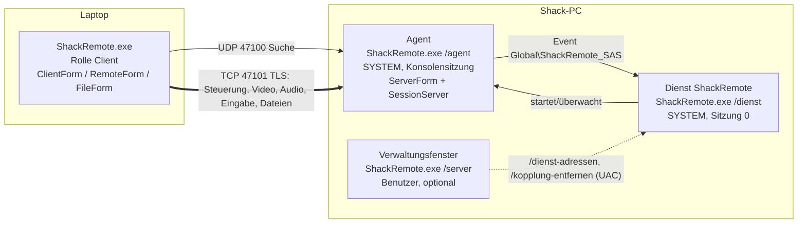
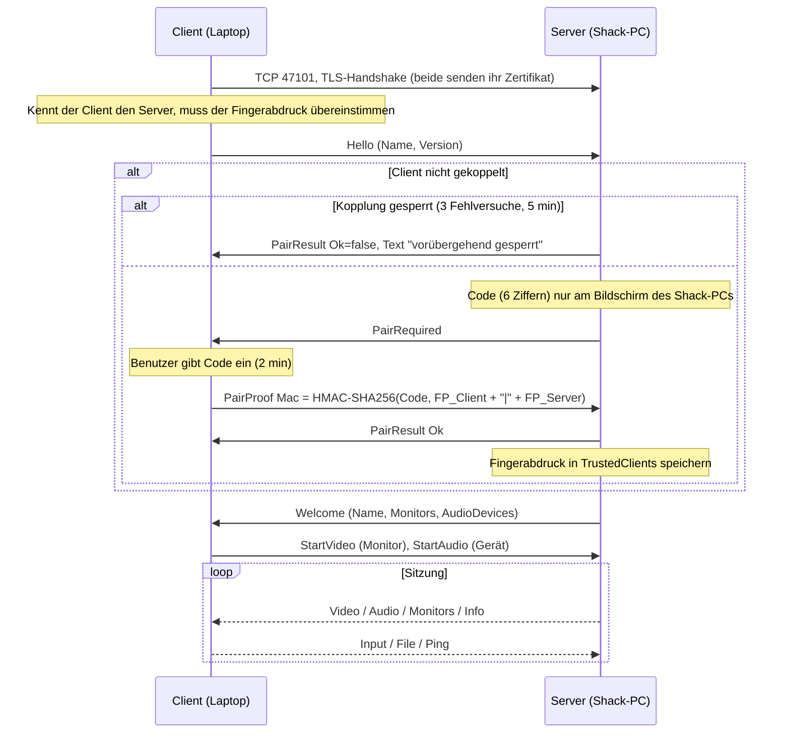
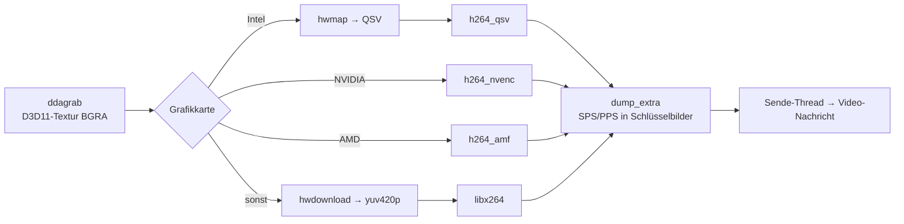
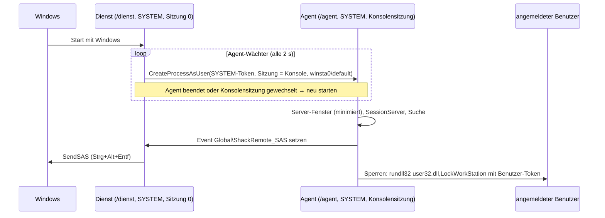

# ShackRemote – Technische Projektbeschreibung

| | |
|---|---|
| **Version** | 1.2.0 |
| **Stand** | 12.11.2026 |
| **Autor** | Axel Baruschke, DK7EE – dk7ee@darc.de |
| **Lizenz** | GNU GPL v3 |
| **Repository** | https://github.com/AxBa1964/ShackRemote |
| **Ergänzend** | [Fachliche Projektbeschreibung](Fachliche-Projektbeschreibung.md) (Ziele, Abläufe, Entscheidungen), [`src/README.md`](../src/README.md) (Entwicklungsnotizen je Stufe), [`tools/stufe0/README.md`](../tools/stufe0/README.md) (Machbarkeitstest) |

Dieses Dokument richtet sich an Entwickler, die ShackRemote übernehmen, bauen, verstehen und erweitern wollen.
Es setzt C#/.NET-Kenntnisse voraus; Windows-, FFmpeg- und Direct3D-Besonderheiten werden erklärt.

---

## 1. Überblick

ShackRemote ist **eine** Windows-Anwendung (WinForms, .NET 10), die je nach Startparameter bzw. Rollenwahl als
**Client** (Laptop), **Server** (Shack-PC), **Windows-Dienst** oder **Server-Agent** läuft.

| Bereich | Technik |
|---|---|
| Sprache / Laufzeit | C#, .NET 10 (`net10.0-windows`), WinForms; `AllowUnsafeBlocks` für FFmpeg/COM |
| Bildaufnahme | FFmpeg-Filter `ddagrab` (Desktop Duplication API, D3D11-Texturen) |
| Bildkodierung | H.264 per `h264_qsv` (Intel), `h264_nvenc` (NVIDIA), `h264_amf` (AMD), Rückfall `libx264` |
| Bilddekodierung / Anzeige | FFmpeg D3D11VA → D3D11 Video Processor (Farbraum + Skalierung) → DXGI-Swapchain (Flip-Discard) |
| Ton | WASAPI (NAudio) → FFmpeg Opus-Encoder (48 kHz, Stereo, 10 ms) → Client: Opus-Decoder → WASAPI |
| Eingabe | Client: `WH_KEYBOARD_LL`-Haken + Mausereignisse; Server: `SendInput` |
| Netzwerk | UDP 47100 (Suche), TCP 47101 (Sitzung) mit TLS (`SslStream`, Version vom Betriebssystem ausgehandelt), eigenes Rahmenprotokoll |
| Identität | Selbst signiertes ECDSA-P-256-Zertifikat je Rechner, Vertrauen per Kopplung (Fingerabdruck-Pinning) |
| Dienstbetrieb | `ServiceBase`, Agent per `CreateProcessAsUser` (SYSTEM-Token) in der Konsolensitzung, `SendSAS` |
| Setup | Inno Setup 7, eigenständige Veröffentlichung (self-contained, single-file) |
| FFmpeg | 9.0.1 „full_build-shared“ (gyan.dev), Anbindung über FFmpeg.AutoGen 9.0.1.1 |

### 1.1 Abhängigkeiten (NuGet)

| Paket | Version | Zweck | Lizenz |
|---|---|---|---|
| FFmpeg.AutoGen | 9.0.1.1 | C#-Anbindung der FFmpeg-DLLs | MIT |
| System.ServiceProcess.ServiceController | 10.0.0 | Windows-Dienst | MIT |
| NAudio.Core / NAudio.Wasapi | 2.2.1 | WASAPI-Aufnahme/-Wiedergabe | MIT |

FFmpeg-DLLs sind **nicht** im Repository; `tools\get-ffmpeg.cmd` lädt sie nach `ffmpeg\bin`
(Quelle: `https://github.com/GyanD/codexffmpeg/releases`, Fassung `ffmpeg-9.0.1-full_build-shared`, GPL v3).
Die Projektdatei kopiert sie bei Build und Publish neben die exe (`ExcludeFromSingleFile`).

---

## 2. Architektur

### 2.1 Prozesse und Rollen



| Betriebsart | Start | Aufgabe |
|---|---|---|
| **Client** | Rolle „Client“ oder `/client` | Suchen, Verbinden, Kopplung, Fernsteuerungs- und Dateifenster |
| **Server (normal)** | Rolle „Server“ ohne Dienst | Server läuft im Fenster des angemeldeten Benutzers (kein Anmeldebildschirm, kein Strg+Alt+Entf) |
| **Dienst** | Windows, `/dienst` | Hält den Agenten in der Konsolensitzung am Leben, löst `SendSAS` aus; keine Oberfläche |
| **Agent** | vom Dienst, `/agent` | Eigentlicher Server als SYSTEM; darf auf den Winlogon-Desktop; minimiertes Fenster „(Dienst)“; Protokoll in `agent.log` |
| **Verwaltung** | Rolle „Server“, wenn der Dienst läuft | Einstellungen des Dienstes ansehen/ändern; lauscht selbst nicht |

`ServerMode` (in `UI/ServerForm.cs`) unterscheidet `Normal`, `Management`, `Agent`.

### 2.2 Projektstruktur

```
ShackRemote/
├─ LICENSE                      GPL v3
├─ README.md                    Überblick, Stufen, Setup, Lizenz
├─ setup.cmd                    Veröffentlichen + Inno Setup + ZIP für die Webseite
├─ publish.cmd                  Nur veröffentlichen (Single-File-exe)
├─ setup/ShackRemote.iss        Inno-Setup-Skript
├─ tools/get-ffmpeg.cmd|.ps1    FFmpeg-DLLs holen
├─ tools/stufe0/                Machbarkeitstest mit ffmpeg.exe (historisch)
├─ docs/                        Diese Dokumentation
└─ src/ShackRemote/
   ├─ ShackRemote.csproj        Version, Pakete, FFmpeg-Kopie, Symbol, eingebettetes Startbild
   ├─ Program.cs                Startparameter, Rollenwahl
   ├─ Assets/                   intro.png (Startbild), shackremote.ico
   ├─ Core/                     Logik ohne Oberfläche
   │  ├─ Media/                 FFmpeg, D3D11, Ton
   │  └─ Service/               Dienst, Agent-Start, Systemaktionen
   └─ UI/                       WinForms-Fenster und Gestaltung
```

| Datei | Aufgabe |
|---|---|
| `Program.cs` | Startparameter auswerten (siehe 7.3), Theme setzen, Startfenster, Rolle wählen, Fenster öffnen |
| **Core** | |
| `AppSettings.cs` | Einstellungen als JSON (`settings.json`); Benutzer- oder Rechnerordner; Kopplungen, bekannte Server, Adressauswahl |
| `Identity.cs` | Eigenes Zertifikat (`identity.pfx`) laden/erzeugen, Fingerabdruck |
| `Protocol.cs` | Ports, `MsgType`, `ControlMessage`, `MonitorInfo`, `ServerInfo`, `FramedConnection`, `Pairing` |
| `Discovery.cs` | `DiscoveryResponder` (Server) und `DiscoveryClient` (Suche per Broadcast/Unicast) |
| `NetInfo.cs` | Lokale IPv4-Adressen mit Broadcast und Netzart (LAN/WLAN/Tailscale) |
| `TailscalePeers.cs` | `tailscale status --json` auswerten → Online-Geräte für die gezielte Suche |
| `SessionServer.cs` | TLS-Server, Kopplung inkl. Sperre, Sitzungsschleife, `VideoChannel`, Monitor-Beobachtung |
| `SessionClient.cs` | TLS-Client, Kopplung, Leseschleife, Ping, Ereignisse für Video/Audio/Dateien |
| `InputProtocol.cs` / `InputInjector.cs` | Eingabenachrichten bauen / per `SendInput` ausführen |
| `Desktop.cs` | Eingabe-Desktop ermitteln und Threads daran binden (Default/Winlogon) |
| `FileProtocol.cs` | Dateinachrichten (JSON + Datenblöcke), `FsOps` (lokale Dateioperationen) |
| `FileService.cs` | Server: Dateianfragen beantworten (als angemeldeter Benutzer) |
| `RemoteFs.cs` | Client: Dateizugriff auf den Shack-PC als `async`-API |
| `Media/ScreenEncoder.cs` | Aufnahme + Kodierung (drei Threads), Encoder-Auswahl |
| `Media/VideoRenderer.cs` | Dekodierung + Anzeige auf der GPU |
| `Media/DxgiOutputs.cs` | Monitore aller Grafikkarten aufzählen |
| `Media/AudioCapture.cs` / `AudioPlayer.cs` | Ton aufnehmen und kodieren / dekodieren und abspielen |
| `Media/FfmpegLib.cs` | FFmpeg-DLLs laden, Fehlertexte |
| `Media/Native.cs` | COM-/DXGI-/D3D11-Strukturen und Hilfen (vtable-Aufrufe) |
| `Service/ShackService.cs` | Windows-Dienst: Agent-Wächter, SAS-Thread |
| `Service/ProcessLauncher.cs` | Prozess als SYSTEM bzw. als Benutzer in einer Sitzung starten |
| `Service/ServiceSetup.cs` | Dienst einrichten/entfernen, Einstellungen übernehmen, Kopplung entfernen |
| `Service/SystemActions.cs` | Strg+Alt+Entf (über Dienst) und Sperren (als Benutzer) |
| `Service/UserContext.cs` | Code im Namen des angemeldeten Benutzers ausführen (Impersonation) |
| `Service/FileLog.cs` | `dienst.log` / `agent.log` in `C:\ProgramData\ShackRemote` |
| **UI** | |
| `IntroForm.cs` | Startfenster mit Bild, Version, Lizenz |
| `RoleForm.cs` | Rollenwahl |
| `ServerForm.cs` | Server-Fenster (Normal/Verwaltung/Agent): Adressen, gekoppelte Geräte, Dienst, Protokoll |
| `ClientForm.cs` | Client-Fenster: Suche, Verbinden, verständliche Fehlertexte |
| `RemoteForm.cs` | Fernsteuerungsfenster: Kopfleiste, Bild, Eingabe, Ton, Statuszeile |
| `VideoPanel.cs` | Zeichenfläche für den Renderer (eigenes Fensterhandle) |
| `KeyboardHook.cs` | Globaler Tastatur-Haken |
| `FileForm.cs` / `FilePane.cs` | Dateifenster (zwei Spalten), `IFileSide` lokal/remote |
| `InputDialog.cs` | Eingabedialog, Kopplungscode mit Maske |
| `Theme.cs` / `LayoutKit.cs` | Farben Hell/Dunkel, Symbolschrift, Bausteine für einheitliche Fenster |

---

## 3. Netzwerk und Protokoll

### 3.1 Suche (UDP 47100)

- **Server** (`DiscoveryResponder`) lauscht auf `0.0.0.0:47100` (ausdrücklich IPv4). Auf die Anfrage
  `SHACKREMOTE_DISCOVER_V1` antwortet er mit `ServerInfo` als JSON (Name, Version, Fingerabdruck, Port, Adressen mit Netzart).
- **Client** (`DiscoveryClient.SearchAsync`) sendet
  1. per **Broadcast** in jedes lokale Netz mit Broadcast-Adresse,
  2. **gezielt** an alle Adressen bekannter Server (`KnownServers`) und
  3. **gezielt** an alle in Tailscale online gemeldeten Geräte (`TailscalePeers`; über Tailscale gibt es keinen Broadcast),
  und sammelt Antworten 1,5 s lang.

### 3.2 Sitzung (TCP 47101, TLS)

`SslStream` mit beidseitigen Zertifikaten. Die Zertifikatskette wird bewusst **nicht** geprüft
(selbst signiert); Vertrauen entsteht durch die Kopplung (Fingerabdruck-Pinning).

**Rahmen** (`FramedConnection`): `[Typ 1 Byte][Länge Int32 LE][Inhalt]`. Senden ist threadsicher
(`SemaphoreSlim`), Lesen erfolgt nur in einer Schleife.

| `MsgType` | Inhalt |
|---|---|
| `Control = 1` | `ControlMessage` als JSON |
| `Video = 2` | `[Merker][H.264-Paket]`, Merker Bit 0 = Schlüsselbild |
| `Audio = 3` | Opus-Paket (10 ms) |
| `Input = 4` | Eingabenachricht (`InputProtocol`) |
| `File = 5` | `[Json][FsMessage]` oder `[Chunk][Transfer Int32 LE][Daten ≤ 64 KB]` |

**Steuernachrichten** (`ControlMessage.Type`):

| Richtung | Typen |
|---|---|
| Client → Server | `Hello`, `PairProof`, `Ping`, `StartVideo`, `StopVideo`, `RequestKeyframe`, `StartAudio`, `StopAudio`, `SendSas`, `Lock` |
| Server → Client | `PairRequired`, `PairResult`, `Welcome`, `Pong`, `VideoReset`, `VideoInfo`, `VideoError`, `Monitors`, `Info` |

### 3.3 Verbindungsaufbau und Kopplung



- **Nachweis:** Der Code wird nie übertragen. Beide Seiten berechnen `HMAC-SHA256(Code, FP_Client|FP_Server)`.
  Sitzt jemand dazwischen (anderes Zertifikat), passen die Fingerabdrücke und damit der Nachweis nicht.
  Vergleich in konstanter Zeit (`CryptographicOperations.FixedTimeEquals`).
- **Bekannte Grenze:** Wer *während* der Kopplung aktiv dazwischen sitzt, könnte den 6-stelligen Code offline aus dem
  Nachweis durchprobieren. Deshalb Kopplung im Heimnetz bzw. VPN; danach gilt nur noch das Zertifikat.
- **Kopplungssperre** (`SessionServer`, statische Felder): 3 falsche Codes → 5 Minuten keine Kopplung; Zähler wird
  bei Erfolg zurückgesetzt. Gilt pro Prozess (Neustart des Agenten setzt sie zurück).
- **Ping** jede Sekunde (`T` = Stopwatch-Ticks) → Umlaufzeit in der Statuszeile.

### 3.4 Ports und Firewall

| Port | Protokoll | Zweck |
|---|---|---|
| 47100 | UDP | Suche |
| 47101 | TCP | Sitzung |

Das Setup legt die eingehende Regel `ShackRemote` für `C:\Program Files\ShackRemote\ShackRemote.exe`, Profile
Privat und Domäne, an (`netsh advfirewall`). Der Server lauscht nur auf den im Server-Fenster ausgewählten Adressen
(`ExcludedAddresses` = abgewählte).

---

## 4. Video-Pipeline

### 4.1 Server: Aufnahme und Kodierung (`ScreenEncoder`)



- **Drei Threads:** Aufnahme → Kodieren → Senden. Zwischen Aufnahme und Encoder liegt **genau ein Platz**:
  Ist der Encoder beschäftigt, ersetzt das neue Bild das ältere (kein Stau, geringste Verzögerung).
  Fertige Pakete gehen über eine Warteschlange an den Sende-Thread.
- **Filtergraph:** `ddagrab=output_idx=<Ausgang>:framerate=60:draw_mouse=1`, danach je Encoder siehe Diagramm.
- **Encoder-Einstellungen** (alle: GOP 2 s, keine B-Bilder, `LOW_DELAY`, `forced_idr`):

  | Encoder | Wichtigste Optionen |
  |---|---|
  | `h264_qsv` | ICQ `global_quality=20`, `async_depth=1` |
  | `h264_nvenc` | `preset=p4`, `tune=ull`, `rc=vbr`, `cq=23`, `zerolatency=1`, `delay=0` |
  | `h264_amf` | `usage=ultralowlatency`, `quality=speed`, `rc=cqp`, `qp_i=22`, `qp_p=24` |
  | `libx264` | `preset=superfast`, `tune=zerolatency`, `crf=23` |

  Details in `ScreenEncoder.OpenWith`.
- **Auswahl:** `Candidates(vendor)` legt die Reihenfolge nach Hersteller fest (Software zuletzt). Was auf einer
  Grafikkarte funktioniert hat, merkt sich `Working`; `/encoder=` setzt `Forced` (ohne Rückfall, für Tests).
- **Schlüsselbilder auf Anforderung:** `RequestKeyframe` setzt beim nächsten Bild `pict_type = I`,
  `AV_FRAME_FLAG_KEY` und `forced_idr` – kein Encoder-Neustart.
- **Desktop-Wechsel:** Der Aufnahme-Thread wird an den Eingabe-Desktop gebunden und prüft alle 250 ms, ob dieser
  gewechselt hat (Anmelde-/Sperrbildschirm → `Winlogon`). Nur im Dienstbetrieb (SYSTEM) erlaubt.
- **QSV-Besonderheit:** Mit den DLL-Fassungen von FFmpeg schlug das Öffnen von `h264_qsv` mit
  „MFX session -9“ fehl. Umgehung: `AVQSVDeviceContext.loader` wird für `avcodec_open2` auf `null` gesetzt,
  damit avcodec einen eigenen oneVPL-Loader erzeugt (Struktur `QsvDeviceContext`, Layout aus `hwcontext_qsv.h` 9.0).

### 4.2 Server: `VideoChannel` und Monitore

- `VideoChannel` (in `SessionServer`) startet/ersetzt den `ScreenEncoder` beim Monitorwechsel und baut die Aufnahme
  nach Zugriffsverlust (Sperrbildschirm, Auflösungswechsel, UAC: `DXGI_ERROR_ACCESS_LOST`) neu auf:
  erste drei Versuche nach 0,3 s, danach alle 2 s.
- `DxgiOutputs.List()` zählt alle Monitore **aller** Grafikkarten (Index = laufende Nummer, Adapter/Output für ddagrab,
  Hersteller für die Encoder-Wahl, Lage auf dem Desktop).
- Während der Sitzung prüft der Server alle 3 s die Monitore (Signatur aus Adapter/Output/Lage/Größe/Haupt).
  Bei Änderung: `VideoChannel.UpdateMonitors` und Nachricht `Monitors` an den Client. Leere Listen
  (z. B. beim Wechsel zum Anmeldebildschirm) werden ignoriert.

### 4.3 Client: Dekodierung und Anzeige (`VideoRenderer`)

- Eigener Thread „Decoder/Anzeige“; die Netzwerk-Leseschleife legt nur Pakete ab.
- FFmpeg-H.264-Decoder mit **D3D11VA** (Bild bleibt als NV12-Textur auf der GPU) →
  **D3D11 Video Processor** (NV12 → BGRA und Skalierung mit Seitenverhältnis in einem Schritt) →
  **Swapchain** (`FLIP_DISCARD`) des `VideoPanel`.
- Die COM-Schnittstellen (ID3D11VideoDevice, ID3D11VideoContext, IDXGISwapChain1 …) werden über **vtable-Indizes**
  aufgerufen (`Native.cs`); die Indizes stammen aus den mingw-w64-IDL-Dateien und sind im Code kommentiert.
- Nach Einstieg, Rückstand oder Decoderfehler wartet der Renderer auf ein Schlüsselbild und fordert es an
  (`KeyframeNeeded` → `RequestKeyframeAsync`).
- `ImageBounds` (Lage des Bildes im Fenster) dient der Umrechnung der Mauskoordinaten.

---

## 5. Ton, Eingabe, Dateien

### 5.1 Ton

- **Server** (`AudioCapture`): WASAPI im geteilten Modus, Quelle = Loopback des Wiedergabegeräts (Id `""` = Standard)
  oder ein Aufnahmegerät (z. B. USB-Soundkarte des Funkgeräts; andere Programme wie WSJT-X können parallel lesen).
  Umwandlung nach Stereo float 48 kHz → Opus (96 kbit/s, 10-ms-Pakete, lowdelay).
- **Client** (`AudioPlayer`): Opus-Decoder → `BufferedWaveProvider` → `WasapiOut` (geteilt, 40 ms Latenz).
  Liegt mehr als 250 ms im Puffer, wird er geleert (Verzögerung bleibt klein; Zähler `Drops`).
- Auswahl der Quelle im Fernsteuerungsfenster, gemerkt in `AudioSource`.

### 5.2 Eingabe

- **Client:** Mausereignisse über dem `VideoPanel` → Koordinaten relativ zum Bild (0..65535).
  `KeyboardHook` (`WH_KEYBOARD_LL`, im UI-Thread) fängt alle Tasten ab, solange das Fenster vorne ist, und sendet
  virtuellen Code + Scancode + Extended-Flag. Strg+Alt+F1…F9 wechselt lokal den Monitor. Beim Verlassen des Fensters
  werden gedrückte Tasten auf dem Server losgelassen.
- **Server:** `InputInjector` führt die Eingaben auf einem eigenen Thread aus, der an den aktiven Desktop gebunden wird
  (im Dienstbetrieb auch Winlogon). Mauspositionen werden auf den virtuellen Gesamtdesktop umgerechnet.
- **Nachrichten** (`InputProtocol`): `MouseMove(x,y)`, `MouseButton(Taste 0–4, gedrückt, x, y)`,
  `MouseWheel(Delta, horizontal)`, `Key(vk, scan, up, extended)`.

### 5.3 Dateien

- Anfrage/Antwort über `FsMessage` (JSON) mit `Id`; Übertragungen in 64-KB-Blöcken mit `Transfer`-Nummer.
- `FileService` (Server) führt alles per `UserContext.Run` im Namen des angemeldeten Benutzers aus
  (`WTSQueryUserToken` + `RunImpersonated`) – im Dienstbetrieb hätte SYSTEM sonst Zugriff auf alles.
- Laufwerke werden sofort gezeigt, Details langsamer (Netz-)Laufwerke werden nachgereicht.
- `RemoteFs` (Client) bietet eine `async`-API; `FileForm`/`FilePane` arbeiten über `IFileSide` (`LocalSide`, `RemoteSide`).

---

## 6. Dienstbetrieb



- **Warum Agent?** Ein Dienst läuft in Sitzung 0 ohne Zugriff auf Bildschirm und Eingabe. Der Agent läuft in der
  Konsolensitzung, aber mit SYSTEM-Rechten – nur so darf er den Winlogon-Desktop (Anmelde-/Sperrbildschirm) öffnen.
- **Strg+Alt+Entf:** `SendSAS` ist Diensten vorbehalten und setzt die Richtlinie `SoftwareSASGeneration` voraus
  (`HKLM\SOFTWARE\Microsoft\Windows\CurrentVersion\Policies\System`; das Setup setzt 1 bzw. 3).
- **Einrichten** (`ServiceSetup.Install`, `/dienst-installieren`): Dienst anhalten → Programm nach
  `C:\Program Files\ShackRemote` kopieren (falls nicht schon dort) → Zertifikat übernehmen (falls noch keins) →
  Datenordner absichern (`icacls`: nur SYSTEM und Administratoren) → Einstellungen übernehmen (`SyncSettings`) →
  Richtlinie setzen → Dienst anlegen (`sc create … start= auto`, Neustart bei Absturz) → starten.
- **SyncSettings:** übernimmt die Adressauswahl (`ExcludedAddresses`) des Benutzers und führt die Kopplungen zusammen;
  `settings.json` des Dienstes wird für Benutzer lesbar (`icacls … /grant *S-1-5-32-545:R`), damit das
  Verwaltungsfenster sie anzeigen kann. `identity.pfx` bleibt nur für SYSTEM/Administratoren lesbar.
- **Verwaltungsfenster:** schreibt in die Benutzereinstellungen; „Für Dienst übernehmen“ ruft `/dienst-adressen`
  mit UAC auf (SyncSettings + Neustart). „Entfernen“ bei gekoppelten Geräten ruft `/kopplung-entfernen=FP`
  (wirkt ohne Neustart, weil der Server die Einstellungen vor jeder Kopplungsprüfung neu lädt).

---

## 7. Konfiguration, Daten, Startparameter

### 7.1 Dateien und Ordner

| Ort | Inhalt | Rechte |
|---|---|---|
| `C:\Program Files\ShackRemote\` | Programm, FFmpeg-DLLs | Standard |
| `%APPDATA%\ShackRemote\identity.pfx` | Zertifikat (normaler Betrieb, Client) | Benutzer |
| `%APPDATA%\ShackRemote\settings.json` | Einstellungen (normaler Betrieb, Client) | Benutzer |
| `C:\ProgramData\ShackRemote\identity.pfx` | Zertifikat des Dienstes/Agenten | SYSTEM, Administratoren |
| `C:\ProgramData\ShackRemote\settings.json` | Einstellungen des Dienstes | zusätzlich Benutzer: lesen |
| `C:\ProgramData\ShackRemote\agent.log`, `dienst.log` | Protokolle (ab 2 MB → `*.old.log`) | SYSTEM, Administratoren |

### 7.2 `settings.json` (`AppSettings`)

| Feld | Rolle | Bedeutung |
|---|---|---|
| `Role`, `RememberRole` | beide | Rollenwahl merken |
| `Design` | beide | `System`, `Hell`, `Dunkel` |
| `ExcludedAddresses` | Server | Abgewählte IPv4-Adressen (dort wird nicht gelauscht) |
| `TrustedClients[]` | Server | `Fingerprint`, `Name`, `PairedAt` |
| `KnownServers[]` | Client | `Fingerprint`, `Name`, `Addresses`, `LastUsed` |
| `AudioSource` | Client | Gewählte Tonquelle (`""` = Standard, `null` = aus) |
| `FileLocalPath`, `FileRemotePath` | Client | Zuletzt geöffnete Ordner im Dateifenster |

### 7.3 Startparameter (`Program.cs`)

| Parameter | Wirkung |
|---|---|
| `/server`, `/client` | Rolle direkt wählen |
| `/rolle` | Rollenwahl erzwingen |
| `/dienst` | Als Windows-Dienst laufen (nur durch Windows) |
| `/agent` | Server-Agent (nur durch den Dienst) |
| `/dienst-installieren`, `/dienst-entfernen` | Dienst einrichten/entfernen (Adminrechte); mit `/still` ohne Erfolgsmeldung (Setup) |
| `/dienst-adressen` | Adressauswahl in den Dienst übernehmen, Dienst neu starten (Adminrechte) |
| `/kopplung-entfernen=FP` | Kopplung beim Dienst und Benutzer entfernen (Adminrechte) |
| `/encoder=qsv\|nvenc\|amf\|cpu` | Encoder erzwingen (Test, ohne Rückfall) |

---

## 8. Bauen, Veröffentlichen, Ausliefern

### 8.1 Entwicklungsumgebung

- Windows 11 x64, .NET 10 SDK, VS Code oder Visual Studio, Git.
- Für das Setup: Inno Setup 7 (https://jrsoftware.org/isdl.php). `setup.cmd` sucht `ISCC.exe` in den üblichen
  Ordnern von Inno Setup 7 und 6 sowie im `PATH`.

### 8.2 Befehle (PowerShell)

```
cd C:\ABDevelop\ShackRemote
.\tools\get-ffmpeg.cmd                         # einmalig: FFmpeg-DLLs nach ffmpeg\bin
dotnet build src\ShackRemote                   # Entwickeln
dotnet run --project src\ShackRemote -- /client
.\setup.cmd                                    # Veröffentlichen + Setup + ZIP
```

`setup.cmd`:
1. liest die Version aus `ShackRemote.csproj`,
2. `dotnet publish -c Release -r win-x64 --self-contained -p:PublishSingleFile=true` nach `publish\app`,
3. `ISCC /DAppVersion=… setup\ShackRemote.iss` → `publish\setup\ShackRemote-Setup-<Version>.exe`,
4. ZIP `publish\setup\shackremote-setup.zip` für die Webseite.

### 8.3 Setup (`setup/ShackRemote.iss`)

- Installiert nach `{autopf}\ShackRemote` (fester Ordner, den der Dienst erwartet), Adminrechte, nur x64.
- Aufgabe „Dieser PC ist der Shack-PC“ → Firewall-Regel + `/dienst-installieren /still`. War der Dienst schon da,
  wird er bei einem Update immer neu eingerichtet (`WantService`).
- `PrepareToInstall`: Dienst anhalten, laufende ShackRemote-Prozesse beenden (Dateien sonst gesperrt).
- Deinstallation: `/dienst-entfernen /still`, Firewall-Regel löschen; Daten bleiben.

### 8.4 Version und Veröffentlichung

1. `<Version>` in `src/ShackRemote/ShackRemote.csproj` erhöhen (Semantik: Major.Minor.Patch). Die Version erscheint in
   Fenstertiteln, Startfenster, Protokoll und Setup.
2. `README.md` (Abschnitt „Neu in …“) und diese Dokumente nachziehen.
3. Commit + Push auf GitHub.
4. `.\setup.cmd`, dann `shackremote-setup.zip` und die Anleitung als `shackremote-anleitung.pdf` nach
   `https://afu-software.de/downloads/` hochladen (Links auf https://dk7ee.de/shackremote.php ohne Versionsnummer).
5. Webseite (`C:\ABDevelop\DO1DPL.web`, `shackremote.php`) bei sichtbaren Änderungen anpassen.

---

## 9. Diagnose und typische Fehler

### 9.1 Werkzeuge

- **Protokolle:** Client- und Server-Fenster (unten), im Dienstbetrieb `C:\ProgramData\ShackRemote\agent.log` und
  `dienst.log` (als Administrator lesen).
- **Statuszeile** im Fernsteuerungsfenster: dekodierte/angezeigte Bilder, Datenrate, Ping, Encoder, Tonpuffer.
- **Server-Protokoll** alle 5 s: aufgenommene/kodierte Bilder, Datenrate, Schlüsselbilder, übersprungene Bilder,
  Zeit je Bild für Kodieren und Senden.
- `/encoder=` zum gezielten Testen eines Encoders.
- Netzwerk: `Test-NetConnection <IP> -Port 47101`, `netstat -ano | findstr 47101`, `tailscale ping <IP>`.

### 9.2 Erfahrungen aus der Entwicklung

| Symptom | Ursache | Lösung |
|---|---|---|
| `h264_qsv`: „MFX session -9“ | oneVPL-Loader von hwcontext passt nicht zu avcodec (DLL-Fassung) | Loader für `avcodec_open2` auf `null` (siehe 4.1) |
| `AcquireNextFrame failed: 887a0026` | `DXGI_ERROR_ACCESS_LOST` (Sperrbildschirm, Auflösung, UAC) | `VideoChannel` baut die Aufnahme neu auf |
| Win+L am Laptop sperrt den Laptop | Windows lässt Win+L/Strg+Alt+Entf nicht abfangen | Menü „…“: Sperren / Strg+Alt+Entf über den Server |
| Fehler 1400 „Fensterhandle“ beim Verbinden | `Button.Image` im `HandleCreated` gesetzt → Neuaufbau während `CreateControl` | Bilder vor dem Anlegen der Fenster setzen |
| Laufwerksliste lädt 19 s | getrennte Netzlaufwerke blockieren | Laufwerke sofort zeigen, Details nachreichen |
| Verbindung über Tailscale: keine Antwort | Tailscale-Adresse in der **Dienst**-`settings.json` abgewählt | Verwaltungsfenster → „Für Dienst übernehmen“ (seit 1.1) |
| Statische Felder `null` beim Start | Reihenfolge statischer Initialisierer in `AppSettings` | `UserFolder` vor `Folder` deklarieren (Kommentar im Code) |
| `Get-NetTCPConnection` zeigt Lauscher nicht | auf dem Shack-PC nicht zuverlässig beobachtet (Ursache unbekannt) | `netstat -ano` verwenden |
| WinForms-Warnung WFO1000 | öffentliche Steuerelement-Eigenschaft würde serialisiert | `[Browsable(false), DesignerSerializationVisibility(Hidden)]` |

---

## 10. Technische Schulden und Hinweise für Erweiterungen

- **Keine automatisierten Tests.** Getestet wurde manuell mit Laptop (Intel Arc, 3200×2000) und Shack-PC (Intel N100,
  drei Monitore 1920×1080). Für Protokoll, `FsOps`, `Pairing`, `AppSettings` wären Unit-Tests leicht möglich.
- **NVIDIA/AMD-Pfade** sind wenig getestet; Encoder-Parameter ggf. anpassen.
- **Dark Mode** nutzt die als experimentell gekennzeichnete WinForms-API `Application.SetColorMode`
  (Warnung `WFO5001` unterdrückt); vollständig nur unter Windows 11.
- **COM über vtable-Indizes** (`VideoRenderer`, `Native.cs`) ist kompakt, aber fehleranfällig bei Änderungen –
  Indizes immer aus den IDL-Dateien belegen.
- **Kopplungssperre** gilt pro Prozess, nicht dauerhaft.
- **Protokollversion:** `Hello`/`Welcome` tragen die Programmversion, eine Prüfung auf Verträglichkeit gibt es nicht.
  Bei inkompatiblen Protokolländerungen eine Mindestversion einführen.
- **Neue Steuernachricht hinzufügen:** Typ in `ControlMessage` dokumentieren, im `switch` von `SessionServer` bzw.
  `SessionClient.ReadLoopAsync` behandeln, ggf. Ereignis im `SessionClient` ergänzen.
- **Neuen Encoder hinzufügen:** `EncoderKind`, `Candidates`, Filterkette und Optionen in `ScreenEncoder`,
  `Describe`/`Parse` ergänzen.
- **Offene fachliche Wünsche:** siehe Fachliche Projektbeschreibung, Abschnitt 10.
